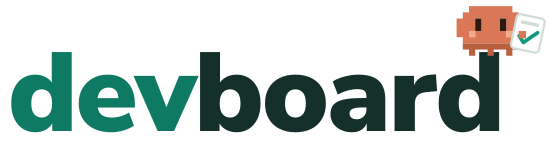
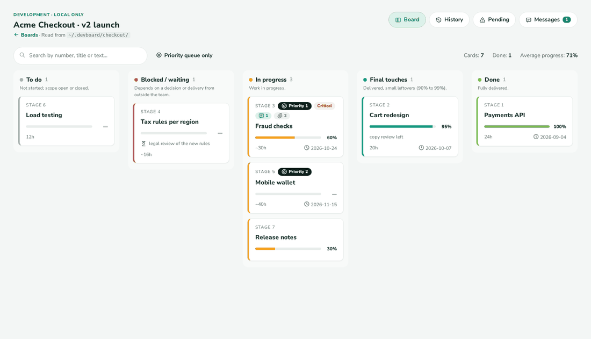
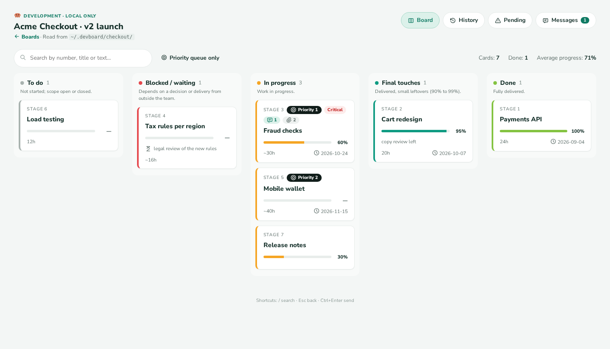
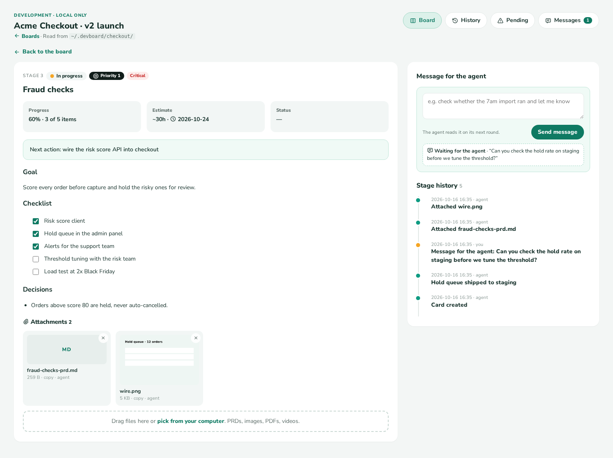
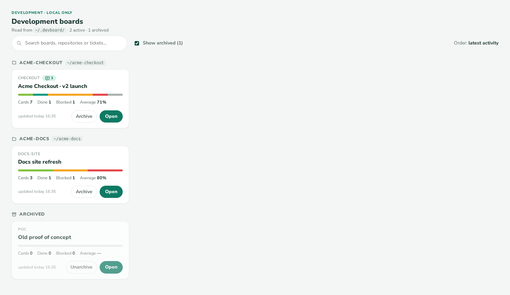

<p align="center">
  <picture>
    <source media="(prefers-color-scheme: dark)" srcset="docs/brand/logo-dark.svg">
    
  </picture>
</p>

<p align="center"><strong>A local Kanban board that your AI agents keep up to date.</strong></p>
<p align="center">They track the work. You see it at a glance, drag cards and leave them messages.</p>

<p align="center">
  <a href="https://github.com/mindtec-victorf/devboard/actions/workflows/tests.yml"></a>
  <a href="LICENSE"></a>
  
  
</p>



---

> **devboard** gives every project a board of cards with checklists, history, attachments and
> messages. Agents update it from the command line; you use it in the browser.

## Why

Long projects with AI agents lose track of themselves. Each new session starts by re-reading a
growing progress file or by you explaining, again, where things stand.

devboard replaces that with a board:

- **Agents resume in seconds.** One command prints one line per card instead of a page of notes.
- **You talk to them without being in the chat.** Leave a message on a card; the agent answers it at
  the start of its next session.
- **Several agents can share a project.** Each one claims the card it works on, so the others pick
  something else.

## Features

- 🤖 **Works with Claude Code, Codex, Gemini CLI, Cursor, GitHub Copilot** and any agent that reads `AGENTS.md`
- 🗂️ **Kanban in the browser.** Drag cards between columns and up or down inside one, tick checklists, search, filter by priority
- 💬 **Messages both ways.** You leave messages for your agents; they ask you for decisions, credentials or tests with `devboard ask`
- 👤 **Who a card is for.** `--for user` or `--for agent[:<name>][@<repo>]`; everything that is for you lands on an automatic **For you** board, across all projects
- 🔔 **Notices.** A desktop notification when an agent hands you something; agents hear about new messages and answers on their next prompt
- 🙋 **Claims.** An agent marks the card it is working on, with its tool's icon (Claude, Gemini, Copilot, Cursor…); claims expire on their own
- 📎 **Attachments.** PRDs, screenshots, PDFs and videos, with previews
- 🧾 **Full history.** Every change records who made it and when; `devboard audit` checks nothing was edited by hand
- 🏠 **All your projects on one screen,** grouped by repository, with archiving
- 🔒 **Local and private.** Plain files in `~/.devboard`, a page on `127.0.0.1`, no account, no cloud
- 🌍 **In your language:** English, Spanish, French, German, Italian, Japanese, Simplified Chinese
- 🪶 **No dependencies.** Python 3.10+ and a browser

## Getting started

### 1. Install

**Claude Code** (recommended, includes the session-start reminder):

```
/plugin marketplace add mindtec-victorf/devboard
/plugin install devboard@devboard
```

**Codex, Gemini CLI, Cursor, Copilot and others:**

```bash
# macOS and Linux
curl -fsSL https://raw.githubusercontent.com/mindtec-victorf/devboard/main/install.sh | sh
```

```powershell
# Windows (PowerShell)
irm https://raw.githubusercontent.com/mindtec-victorf/devboard/main/install.ps1 | iex
```

The installer puts a `devboard` command on your `PATH` and sets up the agents it finds.
[Details per agent](#supported-agents). Claude Code users can run it too, to get the `devboard`
command in their own terminal.

### 2. Create a board

Ask your agent: *"Create a devboard for this project, one card per stage."*

Or do it yourself, from the project folder:

```bash
devboard init checkout --title "Checkout v2" --repo .
devboard add 1 --title "Payments API" --next "write the refund endpoint"
devboard add 2 --title "Fraud checks" --priority 1
```

### 3. Open it

Ask your agent to *"open the devboard"*, or run:

```bash
devboard serve
```

Then go to <http://127.0.0.1:8765>.

## Working with AI agents

The skill teaches every agent the same routine:

1. **Pick a name** for the session: `export DEVBOARD_AGENT=claude-main`. The first word picks the icon on the page
   (`claude`, `gemini`, `copilot`, `cursor`, `codex`; anything else gets a generic one).
2. **Read your messages first:** `devboard inbox`, then `devboard reply <card> <n> "what I did"`.
3. **Look at the board:** `devboard summary` and `devboard who`.
4. **Claim a free card:** `devboard claim <card> --note "what I'm about to do"`.
5. **Record progress as it happens:** `devboard note`, `devboard check`, `devboard attach`, `devboard set --next`.
6. **Hand off when done:** `devboard release <card> --note "done / next / watch out"`.

In Claude Code, the plugin reminds the agent at the start of each session that a board exists and how
many messages are waiting. After that, each prompt brings only what is new since the agent last heard:
a message from you, a card assigned to it, your answer to its request.

### Handing work to the person

When only you can do something (decide, sign in to a panel, pay, test by hand), the agent asks on the card:

```console
$ devboard ask 4 "Which domain should the passkey use?"
4#1 asked the user; the card is assigned to user until they answer
```

The card is now **for you**: it shows on the **For you** board and your desktop shows a notice. You answer
on the card page; the card goes back to the agent that asked, and that agent reads your answer on its next
prompt. Without a question, `devboard set 4 --for user --note "needs the Render card"` hands the card over.

Who a card is for:

| `--for` | Meaning |
|---|---|
| `user` | the person driving the board |
| `agent` | any agent working in the board's folders |
| `agent:<name>` | one agent, by its `DEVBOARD_AGENT` name |
| `agent@<repo>` · `agent:<name>@<repo>` | an agent working in that folder |

`--para` is an alias of `--for`; `--unassign` clears it.

### Several agents at once

```console
$ devboard who
   3 claude-main until 18:30 — tuning the fraud threshold  (Fraud checks)
   6 codex-tests until 17:55 — load test at 2x Black Friday  (Load testing)

$ DEVBOARD_AGENT=claude-review devboard claim 3
conflict: card '3' is claimed by claude-main until 18:30 (tuning the fraud threshold); pick another card or use --force
```

A claim lasts 2 hours unless the agent renews it, so an agent that crashes never blocks a card.
Claims coordinate; they don't lock anything. You can still change any card from the page.

## Working in the browser

| Board | Card |
|---|---|
|  |  |

- **Drag** a card to change its column, or up and down to reorder it. Long columns scroll on their own.
- **Tick** checklist items; the progress bar follows.
- **Drop files** on a card to attach them.
- **Leave a message** for the agent; you'll see its reply on the card.
- **See who** is working on a card, until when, and why, and **who it is for**; change it from the card.
- **Answer the agents' requests** right on the card. The **For you** board, first on the home screen,
  gathers every card that is for you or waits for your answer, from all your boards.

The home screen lists every board you have, grouped by repository:



## Supported agents

| Agent | Setup |
|---|---|
| Claude Code | The plugin ([install](#1-install)). Nothing else to do. |
| OpenAI Codex | The installer adds the skill to `~/.codex/skills` and instructions to `~/.codex/AGENTS.md`. |
| Gemini CLI | The installer adds instructions to `~/.gemini/GEMINI.md`. |
| GitHub Copilot | The installer adds the skill to `~/.copilot/skills`. In each project: `devboard setup-agent copilot`. |
| Cursor | In each project: `devboard setup-agent cursor`. |
| Anything else | In each project: `devboard setup-agent agents` writes `AGENTS.md`. `--print` shows the text to paste elsewhere. |

Running `setup-agent` again updates the instructions in place.

## Reference

<details>
<summary><strong>Commands</strong></summary>

| Command | What it does |
|---|---|
| `init <id> --title T --repo <folder>` | Create a board linked to a folder |
| `add <card> --title T` | Add a card (`--priority`, `--tag`, `--estimate`, `--due`, `--next`, `--for`) |
| `set <card> ...` | Change a card (`--progress`, `--block`, `--wait`, `--next`, `--status`, `--for`/`--unassign`, `--note`) |
| `note <card> "text"` | Record a milestone |
| `check <card> <n>` | Tick checklist item *n* (`--undo` to untick) |
| `move <card> <column>` | Move a card: `todo`, `blocked`, `doing`, `final`, `done` (`--rank` sets its place; lower goes first) |
| `claim <card>` · `release <card>` · `who` | Claim a card, release it, list claims |
| `inbox` · `reply <card> <n> "text"` | Read messages · answer one |
| `ask <card> "text"` · `requests` | Ask the person for something · list what waits for them (`--all`: every board) |
| `attach <card> <file>` · `files <card>` · `detach <card> <name>` | Attachments (`--link` keeps the file where it is) |
| `summary` · `show <card>` · `history` · `pending` | Read the board (`--json` for scripts) |
| `boards` · `archive <id>` · `unarchive <id>` | Manage boards |
| `apply <file.json>` | Run many changes at once; nothing is written if one is invalid |
| `validate` · `audit` | Check the files · check the history matches them |
| `serve` | Start the page (`--port`, default 8765) |
| `hint` · `setup-agent <agent>` | One-line status for this folder · instructions for an agent |

Every command has `--help`. Exit codes: `0` ok, `1` problems found, `2` usage error, `3` conflict.

</details>

<details>
<summary><strong>Configuration</strong></summary>

| Variable | Default | What it sets |
|---|---|---|
| `DEVBOARD_HOME` | `~/.devboard` | Where boards are stored |
| `DEVBOARD_AGENT` | — | The agent's name, used for claims and to sign changes |
| `DEVBOARD_LANG` | `en` | Language of the page: `en`, `es`, `fr`, `de`, `it`, `ja`, `zh-CN`. Each file in `skills/devboard/web/i18n/` is a language; to add one, copy `en.json` and translate it |
| `DEVBOARD_TEMPLATE` | `stages` | Template used by `init` |
| `DEVBOARD_ROLLOUTS` | `~/.devboard/rollouts` | Folders scanned for rollout ledgers |
| `DEVBOARD_NOTIFY` | `1` | `0` turns off the desktop notice when an agent hands you something |
| `DEVBOARD_NOTIFY_CMD` | — | A shell command to run instead of the desktop notice (phone push, chat webhook…); it gets `DEVBOARD_NOTIFY_TITLE` and `DEVBOARD_NOTIFY_BODY` |

In Claude Code you can set them in `settings.json`, under `"env"`.

</details>

<details>
<summary><strong>Where the data lives</strong></summary>

Everything is plain files under `~/.devboard`, never inside your repositories:

```
~/.devboard/<board>/board.json         board title, linked folders, columns
~/.devboard/<board>/cards/<id>.json    card fields
~/.devboard/<board>/cards/<id>.md      long text: goal, context, checklist, decisions
~/.devboard/<board>/cards/<id>.jsonl   history (append-only)
~/.devboard/<board>/files/<id>/        attachments
```

Back it up, sync it, or keep it in a private Git repository.

</details>

<details>
<summary><strong>Security</strong></summary>

devboard is a local tool for one person's machine.

- The page only listens on `127.0.0.1` and rejects requests for any other host name.
- Changes from the page need a header that other websites cannot send.
- Attachments open in a sandbox, so an attached HTML file can't act on the board.
- Attachment names are cleaned of paths and unsafe characters.

There are no user accounts. Don't run `devboard serve` on a shared server.

</details>

<details>
<summary><strong>Rollout ledgers</strong></summary>

If you apply one change across many repositories or tickets, a `STATUS.json` ledger shows up as a
read-only board, one card per unit and one column per phase:

```json
{"meta": {"project": "Upgrade logging", "phases": ["read", "apply", "done"]},
 "units": {"billing-api": {"phase": "apply", "status": "in_progress", "blockers": [], "result": {"tests": "41/41"}}}}
```

Put it in `~/.devboard/rollouts/<name>/STATUS.json`, or run `devboard link-rollout <path>`.

</details>

## Development

```bash
git clone https://github.com/mindtec-victorf/devboard && cd devboard/skills/devboard
python3 -m pytest -q                      # browser tests run if Playwright is installed
python3 ../../docs/make-screenshots.py    # rebuild the screenshots and the GIF
python3 ../../docs/make-logo.py           # rebuild the logo and the favicon
```

Tests run on Linux, macOS and Windows on every push.

## Credits

The idea and the design come from **Rogério Dornelas**, who built a development-only page that shows
a JSON file his AI agent keeps updated. devboard turns it into a plugin anyone can install.

The mascot is an original pixel character made for devboard. Agent icons come from
[Simple Icons](https://simpleicons.org) (CC0); the trademarks belong to their owners and only identify each tool. Font: Nunito Sans, © The Nunito Sans
Project Authors, SIL Open Font License 1.1.

## License

[MIT](LICENSE)
